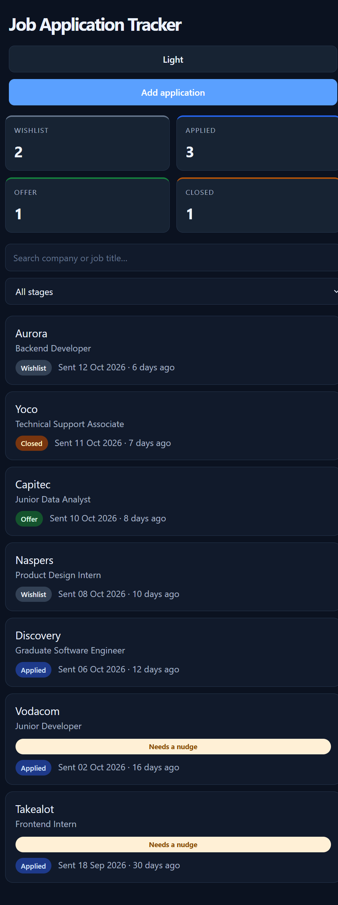

# Applied

Applied is a browser-based job application tracker. It stores application data in
the browser's `localStorage`; no account or server is required.

## Screenshot



## Run locally

```sh
npm install
npm run dev
```

Open the local URL printed by Vite. The app seeds seven sample applications on
first use. Production assets can be built with `npm run build`, and `npm run lint`
checks the source. Run the unit tests with `npm test`.

Applications move through four stages: `wishlist`, `applied`, `offer`, and
`closed`. Existing records from earlier versions that used `saved` or `interview`
are migrated to `wishlist` and `applied`, respectively.

## Tools

- React and TypeScript for the interface and application logic
- Vite for local development and production builds
- Tailwind CSS v4 for utility styling and responsive layout
- React Router for list, add, detail, and not-found routes
- React Hook Form for form state and validation
- Local shadcn-style Button, Card, Input, Label, and Badge primitives
- Browser `localStorage` for persistent application data and theme preference
- React Testing Library and Vitest for UI and unit tests, plus Oxlint for linting

## Profiler note

Use the React DevTools Profiler on the application list when checking for
unnecessary renders. Stage counts and filtered results are derived from the
application records; with the small local dataset, no memoization is needed
unless profiling shows it is worthwhile.

## Structure

- `src/types.ts` defines the application record and its stage union.
- `src/data/seed.ts` contains the first-run sample applications.
- `src/lib/applications.ts` contains pure stage-counting, filtering, and nudge
  calculations.
- `src/api/applications.ts` implements the asynchronous localStorage data layer.
- `src/hooks/useApplications.ts` owns loading, error, refresh, and write behavior.
- `src/context/` stores the shared, persistent theme preference.
- `src/components/` contains application, filter, summary, stage-badge, and
  reusable UI components.
- `src/lib/validation.ts` defines pure form-validation rules.
- `src/App.tsx` configures the shared layout and the list, add, detail, and
  not-found routes.

Application data stays on the current browser and machine. Clearing site data
will remove it.
